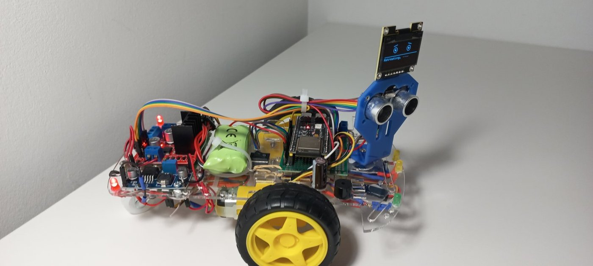

# BitVolts — O meu primeiro robô

[](https://github.com/luanabuscariolo/bitvolts-o-meu-primeiro-robo/actions/workflows/compilar.yml)

Código e material de apoio do livro **BitVolts — O meu primeiro robô**, de Luana Buscariolo.

Um robô de duas rodas que anda sozinho, deteta obstáculos com um sensor de ultrassom, olha para os dois lados antes de decidir o caminho — e comenta o que faz num pequeno ecrã que é o seu rosto.



Este repositório **acompanha o livro**: aqui está o código pronto a gravar, com comentários mais detalhados do que cabem nas páginas, e as referências de montagem para imprimir. As explicações, os passos e as verificações de cada etapa estão no livro.

---

## Por onde começar

1. Instale o ambiente seguindo o capítulo 4 do livro. As versões exatas estão em [docs/AMBIENTE.md](docs/AMBIENTE.md).
2. Nesta revisão, selecione **codex/correcoes-bitvolts** no seletor de branches antes de descarregar. Descarregue este repositório: botão verde **Code → Download ZIP**, e descompacte numa pasta que consiga encontrar.
3. No Arduino IDE, use **Ficheiro → Abrir** (File → Open) e escolha o arquivo `.ino` da etapa em que está.

> **A pasta tem de ter o mesmo nome do arquivo `.ino`.** É uma regra do Arduino IDE. Não mude o nome das pastas nem tire os arquivos de dentro delas.

---

## O que usar em cada capítulo

| Capítulo do livro | O que abrir | Onde |
|---|---|---|
| 4 — Ferramentas e ambiente | `primeiro_teste` | [exemplos/cap04](exemplos/cap04) |
| 10 — Testar peça a peça | `teste_display`, `teste_sensor`, `teste_servo`, `teste_buzzer`, `teste_leds`, `teste_motores`, `teste_bateria` | [exemplos/cap10](exemplos/cap10) |
| 11 e 12 — Corpo completo e chassi | `teste_corpo_completo` | [firmware/teste_corpo_completo](firmware/teste_corpo_completo) |
| 13 — O primeiro programa | `estudar_led` | [exemplos/cap13](exemplos/cap13) |
| 15 — FreeRTOS e tarefas | `teste_dois_nucleos` | [exemplos/cap15](exemplos/cap15) |
| 16 e 17 — Fila e travas | `teste_fila` | [exemplos/cap16](exemplos/cap16) |
| 19 e 20 — Firmware completo e ajustes | `grump_v3` | [firmware/grump_v3](firmware/grump_v3) |

Os testes do capítulo 10 que não precisam de programa próprio — a placa a arrancar com bateria (teste 1) e o capacitor (teste 8) — estão descritos só no livro.

---

## Referências de montagem

| Para quê | Arquivo |
|---|---|
| Todas as ligações, fio a fio, para imprimir e riscar | [hardware/LIGACOES.md](hardware/LIGACOES.md) |
| Lista de compras | [hardware/LISTA-DE-COMPRAS.md](hardware/LISTA-DE-COMPRAS.md) |
| Pinagem dos sinais | [hardware/diagramas/pinagem.png](hardware/diagramas/pinagem.png) |
| Mapa completo dos sinais | [hardware/diagramas/mapa-sinais.png](hardware/diagramas/mapa-sinais.png) |
| Mapa completo da alimentação | [hardware/diagramas/mapa-alimentacao.png](hardware/diagramas/mapa-alimentacao.png) |
| Os quatro nós do barramento | [hardware/diagramas/quatro-nos.png](hardware/diagramas/quatro-nos.png) |

---

## Organização

```
bitvolts-o-meu-primeiro-robo/
├── exemplos/              programas curtos, um por teste, organizados por capítulo
│   ├── cap04/
│   ├── cap10/
│   ├── cap13/
│   ├── cap15/
│   └── cap16/
├── firmware/
│   ├── teste_corpo_completo/   diagnóstico com tudo ligado (capítulos 11 e 12)
│   └── grump_v3/               o firmware final do robô (capítulos 19 e 20)
├── hardware/
│   ├── LIGACOES.md
│   ├── LISTA-DE-COMPRAS.md
│   └── diagramas/
└── docs/
    └── AMBIENTE.md        versões do IDE, do pacote e das bibliotecas
```

---

## Antes de energizar qualquer coisa

- Monte sempre com a energia **desligada**.
- Confira as ligações antes de ligar a bateria.
- Nos testes com motores, deixe as **rodas no ar**.
- Se algo aquecer, cheirar a queimado ou fizer ruído estranho, desligue imediatamente.
- Os ajustes do LM2596 vêm **antes** de ligar qualquer componente a ele (capítulo 9).

---

## Encontrou um problema?

Abra uma *issue* neste repositório indicando o capítulo, o programa, as versões que instalou e a mensagem de erro completa. Correções ao código ficam registadas em [CHANGELOG.md](CHANGELOG.md).

---

## Licença

O **código** (pastas `exemplos/` e `firmware/`) está sob a [licença MIT](LICENSE): pode usá-lo, alterá-lo e partilhá-lo, mantendo o aviso de autoria.

Os **diagramas, fotografias e textos** (pastas `hardware/` e `docs/`) são © 2026 Luana Buscariolo, todos os direitos reservados. Servem para apoiar quem tem o livro e não podem ser redistribuídos separadamente.
